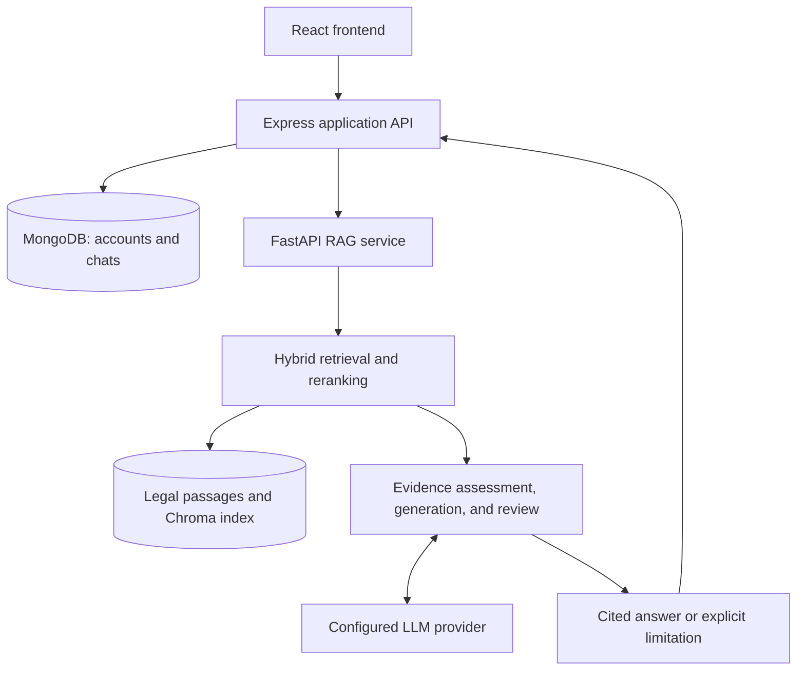

<div align="center">

# Nyaayukti

**An AI-powered Indian legal information assistant using hybrid retrieval and large language models**

B.Tech Final-Year Major Project · Computer Science & Engineering (AI & ML)  
MCKV Institute of Engineering · Batch 2023–2027

[Overview](#overview) · [Local Setup](#local-setup) · [Configuration](#configuration) · [Troubleshooting](#troubleshooting) · [Project Team](#project-team)

</div>

---

## Overview

Nyaayukti explores how Retrieval-Augmented Generation (RAG) can make Indian legal information easier to search, understand, and inspect. The application retrieves passages from a bundled legal corpus, supplies relevant evidence to a configured language model, and presents answers with references to the retrieved material.

Developed as a B.Tech final-year major project, it combines a React interface, an Express application server, MongoDB persistence, and a FastAPI retrieval and generation service. The project emphasizes traceable sources, issue-specific retrieval, and transparent handling of incomplete evidence or unavailable model access.

> **Academic prototype:** Nyaayukti provides legal information and research assistance. Its responses can contain errors and do not replace advice from a qualified advocate. Citations and automated review do not guarantee legal correctness or current-law coverage.

## Problem Statement

Legal documents often contain dense language, complex cross-references, and provisions whose applicability depends on dates and jurisdiction. General-purpose language models can produce convincing statements without reliable legal support.

This project investigates a source-grounded workflow that helps users ask natural-language questions, inspect supporting passages, and recognize where the available evidence is insufficient.

## Objectives

- Improve access to understandable Indian legal information.
- Combine keyword and semantic retrieval for relevant passage discovery.
- Connect generated explanations to inspectable source excerpts.
- Identify material issues and gaps in retrieved evidence.
- Preserve conversation history through authenticated, user-specific sessions.
- Evaluate retrieval quality, citation integrity, and operational reliability.

## Implementation Highlights

| Component | Capability in the supplied implementation |
| --- | --- |
| User interface | React chat interface, authentication screens, conversation history, and expandable source cards |
| Application backend | Express routing, request validation, session ownership, rate limiting, and MongoDB persistence |
| Retrieval | Lexical and dense retrieval, reciprocal-rank fusion, and optional cross-encoder reranking |
| Evidence workflow | Issue planning, bounded follow-up retrieval, evidence coverage assessment, and quote checks |
| Generation | Configurable model adapters, cited answer generation, and a separate structured review stage |
| Failure handling | Retrieval-only responses when model access or answer review is unavailable |
| Development tooling | Local environment configuration, coordinated service launchers, setup checks, and index checks |

These describe code capabilities, not a claim that every configuration has passed live end-to-end evaluation. In particular, quotation matching establishes provenance; it does not independently establish that a legal conclusion is correct.

## Architecture



### Answer Workflow

1. Validate the question and obtain bounded conversation context.
2. Identify material issues and construct retrieval queries.
3. Retrieve and rank candidate passages from the available corpus.
4. Assemble context and assess evidence coverage.
5. Perform bounded follow-up retrieval where useful.
6. Generate an answer and review its source support.
7. Validate quotation references and render citations.
8. Return the answer, evidence limitations, or a clearly labeled fallback.

## Technology Stack

| Layer | Technologies |
| --- | --- |
| Frontend | React 19, Vite 8, React Markdown |
| Backend | Node.js, Express 4, Mongoose |
| Persistence | MongoDB |
| RAG service | Python, FastAPI, Pydantic |
| Retrieval | Lexical search, dense embeddings, reciprocal-rank fusion |
| Embeddings | Sentence Transformers; configured default: `BAAI/bge-small-en-v1.5` |
| Reranking | Configured default: `BAAI/bge-reranker-base` |
| Vector storage | ChromaDB |
| Generation | Gemini or the configured OpenAI-compatible adapter |
| Testing | pytest and Node.js test tooling |

Dependency manifests and lockfiles are authoritative for exact package versions.

## Repository Structure

| Path | Purpose |
| --- | --- |
| `frontend/` | Browser interface, chat components, citations, and frontend tests |
| `backend/` | Express API, authentication, MongoDB models, and RAG client |
| `rag-service/` | FastAPI service, ingestion, retrieval, model adapters, and generation |
| `rag-service/data/raw/` | Bundled source PDFs |
| `rag-service/data/processed/` | Extracted documents, canonical chunks, and manifests |
| `evaluation/` | Evaluation utilities and review outputs |
| `tests/` | Project-level tests |
| `scripts/` | Configuration, launch, diagnostic, and index utilities |
| `docs/` | Architecture, data coverage, validation, and demonstration notes |

## Local Setup

### 1. Install Prerequisites

| Requirement | Project baseline |
| --- | --- |
| Node.js | **22.12 or newer**, as required by the supplied JavaScript manifests |
| Python | **3.12**, the baseline documented for this project |
| npm | Included with Node.js |
| Git | Required to clone the repository |
| MongoDB | A running local MongoDB server or an accessible MongoDB deployment |
| LLM access | A valid provider API key and a model available to that account |
| Internet | Required for dependency installation, initial model downloads, and hosted LLM requests |

A GPU is not required for the documented local workflow. Embedding and reranking dependencies can require substantial download space and memory; the first query may be slower while models load.

Docker configuration is not included in the supplied project. Use the native setup below.

### 2. Obtain the Project

Once the project files have been pushed to the repository:

```bash
git clone https://github.com/imyuvraj09/Nyaayukti.git
cd Nyaayukti
```

If using a downloaded ZIP, extract it and open a terminal in the directory containing the root `package.json`, `requirements.txt`, and `scripts/` folder. Substitute your own repository URL if the owner or repository name differs.

### 3. Create the Python Environment

Create **`.venv` in the project root**. The development launcher looks for this location.

**Windows PowerShell**

```powershell
py -3.12 -m venv .venv
.\.venv\Scripts\Activate.ps1
python -m pip install --upgrade pip
python -m pip install -r requirements.txt
```

**macOS / Linux**

```bash
python3.12 -m venv .venv
source .venv/bin/activate
python -m pip install --upgrade pip
python -m pip install -r requirements.txt
```

If PowerShell prevents activation, use the environment's interpreter directly:

```powershell
.\.venv\Scripts\python.exe -m pip install -r requirements.txt
```

For later Python commands, either activate `.venv` or replace `python` with its interpreter path.

### 4. Install JavaScript Dependencies

From the project root:

```bash
npm run install:all
```

This installs backend and frontend dependencies using their committed lockfiles.

### 5. Generate Local Configuration

```bash
python scripts/configure_local.py
```

This creates:

- `backend/.env`
- `rag-service/.env`
- `frontend/.env`

It also generates matching service tokens and consistent default ports. It refuses to overwrite existing configuration. If any of these files already exist, inspect and edit them using the corresponding `.env.example` templates instead of deleting working credentials.

### 6. Configure MongoDB and the Model

Start your MongoDB server. In `backend/.env`, confirm:

```dotenv
MONGODB_URI=mongodb://127.0.0.1:27017/nyaayukti
```

If using a remote deployment, supply its connection string and configure access appropriately. Keep credentials out of version control.

In `rag-service/.env`, configure one provider. For the default Gemini adapter:

```dotenv
LLM_PROVIDER=gemini
GEMINI_API_KEY=YOUR_GEMINI_API_KEY
LLM_MODEL=YOUR_AVAILABLE_MODEL_ID
```

Replace placeholder values with actual credentials and an available model identifier. A model name alone does not grant account access or quota.

The alternative adapter uses `LLM_PROVIDER=openai`, `OPENAI_API_KEY`, and `LLM_MODEL`. Optional custom endpoint configuration uses `LLM_BASE_URL`; consult `rag-service/llm/` and `rag-service/utils/config.py` before changing providers.

### 7. Validate Setup

From the project root:

```bash
npm run check:setup
python scripts/check_index.py
```

Resolve configuration or index errors before launching the full application. These checks do not establish that the provider will successfully generate an answer.

### 8. Start the Application

```bash
npm run dev
```

| Service | Default address |
| --- | --- |
| Web application | http://localhost:5173 |
| Backend API | http://127.0.0.1:3000 |
| Backend health endpoint | http://127.0.0.1:3000/api/health |
| RAG service | http://127.0.0.1:8000 |

Open the web application, register or sign in, and submit a question. Inspect the response and its source cards. Use `Ctrl+C` to stop the development processes.

For troubleshooting, open three terminals in the project root and run one command in each:

```bash
npm run dev:rag
```

```bash
npm run dev:backend
```

```bash
npm run dev:frontend
```

## Configuration

| File | Setting | Purpose |
| --- | --- | --- |
| `backend/.env` | `PORT` | Backend listening port; default `3000` |
| `backend/.env` | `MONGODB_URI` | Database connection |
| `backend/.env` | `FRONTEND_URL` | Allowed frontend origin |
| `backend/.env` | `RAG_SERVICE_URL` | Python service address |
| `backend/.env` | `RAG_SERVICE_TIMEOUT_MS` | Gateway request timeout |
| Both backend and RAG `.env` files | `RAG_SERVICE_TOKEN` | Matching server-to-server authentication token |
| `rag-service/.env` | `LLM_PROVIDER`, `LLM_MODEL` | Model adapter and model identifier |
| `rag-service/.env` | `GEMINI_API_KEY` / `OPENAI_API_KEY` | Selected provider credentials |
| `rag-service/.env` | `RETRIEVAL_MODE` | Retrieval configuration; default `hybrid` |
| `rag-service/.env` | `ENABLE_RERANKER` | Enables or disables cross-encoder reranking |
| `rag-service/.env` | `VECTOR_COLLECTION_NAME` | Existing vector collection identifier |
| `frontend/.env` | `FRONTEND_PORT` | Frontend port; default `5173` |
| `frontend/.env` | `BACKEND_PROXY_URL` | Backend destination for the development proxy |
| `frontend/.env` | `VITE_API_BASE_URL` | Browser API path; default `/api` |

Keep the existing collection name `nyayasetu_legal_documents` unless intentionally rebuilding or migrating the index. It is a historical storage identifier, not the displayed product name.

For a lightweight retrieval diagnostic, set:

```dotenv
RETRIEVAL_MODE=lexical
ENABLE_RERANKER=false
```

This disables vector retrieval and reranking. It is useful for isolating model-loading problems but is not equivalent to the full hybrid configuration. Restart the RAG service after changing settings.

Never place provider secrets in frontend variables: browser-delivered configuration is not private. Account recovery also requires a separately configured mail delivery service.

## Legal Corpus and Data Management

The supplied project documents a base corpus of 6,545 passages from 14 legal documents, plus three supplemental commencement-notification passages. Treat these as snapshot counts and recheck them after any corpus update.

The bundled material includes the Constitution of India; BNS, BNSS, and BSA; consumer protection and information technology legislation; Companies Act; GST material; Insolvency and Bankruptcy Code; Motor Vehicles Act; RTI; POCSO; Right to Education; and workplace sexual-harassment legislation.

Document inclusion does not establish complete, current, or accurate legal coverage. State laws, amendments, specialist rules, and judgments require additional sourcing. Verified judgment retrieval is not implemented in the supplied pipeline.

For normal setup, use the supplied processed corpus and matching index. Before adding documents:

1. Record source provenance, version, relevant dates, and jurisdiction.
2. Inspect extraction quality and statutory boundaries.
3. Process the new documents through the ingestion and chunking modules.
4. Rebuild affected embeddings and index records.
5. Run index checks and evaluate retrieval against representative questions.

The ingestion entry points are `ingestion/ingestion_pipeline.py`, `ingestion/chunking_pipeline.py`, and `vectorstore/vectorstore_pipeline.py` inside `rag-service/`. Review their CLI options before executing a rebuild. Keep the canonical JSONL corpus and vector index synchronized.

## Testing and Evaluation

From the project root, with `.venv` active:

```bash
python -m pip install -r requirements-dev.txt
python -m pytest -q
npm run test:security --prefix backend
npm test --prefix frontend
npm run lint --prefix frontend
npm run build --prefix frontend
```

The backend API suite can also be run with:

```bash
npm test --prefix backend
```

It starts a temporary MongoDB instance and may require a supported MongoDB binary download.

Evaluate the system across retrieval relevance, issue coverage, source support, citation integrity, appropriate abstention, and latency. Include definitions, multi-issue scenarios, ambiguous facts, missing corpus coverage, provider failures, and conversation follow-ups.

Automated test success does not establish legal accuracy. Live provider tests and source-backed human review should be reported separately. Consult [the validation report](docs/FINAL_REVIEW.md) for the recorded results and limitations of the supplied revision.

## Troubleshooting

| Symptom | What to check |
| --- | --- |
| Node engine or Vite compatibility error | Confirm `node --version` is at least 22.12; reinstall dependencies using `npm run install:all` |
| Python module not found | Confirm dependencies were installed into the root `.venv`, not another Python environment |
| Configuration script refuses to run | One or more `.env` files already exist; edit them using the service templates |
| Backend cannot connect to MongoDB | Start MongoDB and check connection string, credentials, and network access |
| Backend cannot reach RAG | Confirm the Python service is running and `RAG_SERVICE_URL` matches its port |
| Service authentication fails | Confirm both services use the same generated `RAG_SERVICE_TOKEN` |
| First query is slow | Embedding and reranking models may still be downloading or loading |
| “Retrieved excerpts only” appears | Retrieval ran, but generation or review was unavailable; inspect RAG logs and check model access, quota, timeouts, and structured-output errors |
| Sources appear irrelevant | Check the query, corpus coverage, retrieval configuration, and extraction quality |
| Index validation fails | Check collection name and corpus/index consistency; do not rename a collection to hide the mismatch |
| Sign-in request is blocked | Use the configured frontend origin and verify proxy/backend settings |
| Password recovery does not deliver email | Configure the supported mail delivery integration |

When reporting a problem, include the request ID, service affected, sanitized error, and reproduction steps. Never include API keys, connection credentials, or sensitive case details.

## Project Scope and Roadmap

The current scope is a local academic application with a bundled statutory corpus and configurable hosted generation. Future work includes:

- Broader official-source coverage and amendment/version tracking.
- Verified judgment ingestion and paragraph-level references.
- Stronger claim-to-evidence validation and human-reviewed benchmarks.
- Improved multilingual and Hinglish query evaluation.
- Better incomplete-evidence and provider-failure presentation.
- Deployment automation and evaluation under concurrent workloads.

These are development directions, not claims of completed functionality.

## Documentation

- [Architecture](docs/ARCHITECTURE.md)
- [Data coverage and evidence limits](docs/DATA.md)
- [Review notes](docs/REVIEW.md)
- [Validation report](docs/FINAL_REVIEW.md)
- [Demo and viva preparation](docs/DEMO_AND_VIVA.md)

## Project Team

**Institution:** MCKV Institute of Engineering  
**Department:** Computer Science & Engineering (Artificial Intelligence & Machine Learning)  
**Project:** B.Tech Final-Year Major Project  
**Supervisor:** [Dr. Deep Suman Dev](https://www.linkedin.com/in/dr-deep-suman-dev-phd-8a500622/)

| Member | Role |
| --- | --- |
| [Yuvraj Singh](https://www.linkedin.com/in/imyuvraj-singh/) | Lead Developer |
| [Sunit Das](https://www.linkedin.com/in/dassunit/) | Developer |
| [Raju Shaw](https://www.linkedin.com/in/rajushaw-tech4u/) | Developer |
| [Pallab Bag](https://www.linkedin.com/in/pallab-bag/) | Developer |
| [Sumit Kumar Nath](https://www.linkedin.com/in/sumit-nath-b8b972198/) | Developer |
| [Nababrato Bishwas](https://www.linkedin.com/in/nababrato-biswas-77bb992b7/) | Developer |

## Contributing

Open an issue with a clear reproduction or proposed improvement. For code changes, create a focused branch, add relevant tests, run affected checks, and submit a pull request describing the change and its validation. Preserve attribution and disclose external assistance appropriately in academic submissions.

## Responsible Use and License

Use synthetic or anonymized examples during demonstrations. Questions and retrieved context may be sent to the configured external model provider; avoid submitting confidential material without appropriate permission. Review authentication, data retention, and operational safeguards before any public deployment.

The application code is distributed under the [MIT License](LICENSE). Bundled legal documents and third-party assets retain their respective rights and terms; the code license does not independently establish redistribution rights for those materials.

## Acknowledgements

We acknowledge our project supervisor, MCKV Institute of Engineering, the maintainers of the open-source libraries used in this project, and the public legal-document sources supporting this research.
