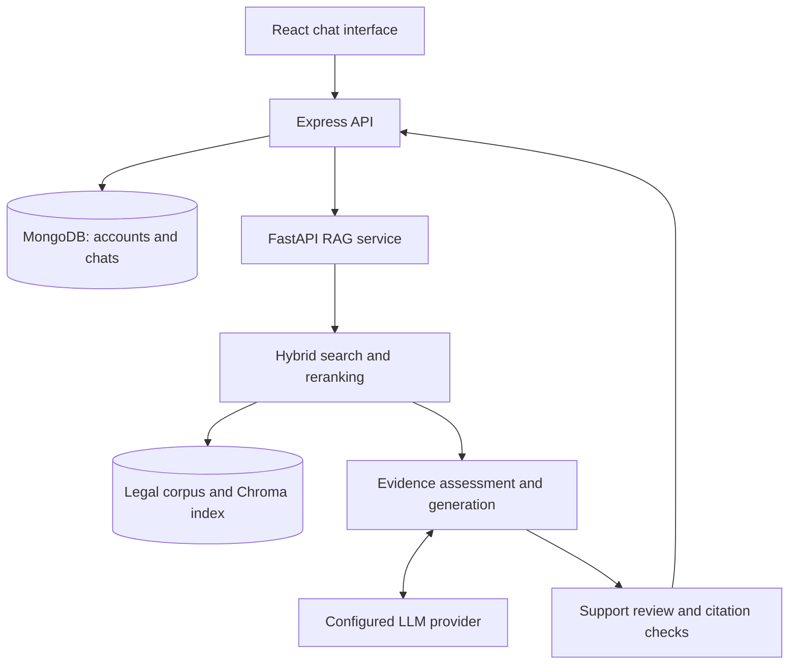

<div align="center">


# ⚖️ Nyaayukti: AI-Powered Legal Assistant

### Making Indian legal information easier to understand and explore

[](https://github.com/imyuvraj09/Nyaayukti/stargazers)
[](https://github.com/imyuvraj09/Nyaayukti/forks)
[](LICENSE)


**MCKV Institute of Engineering**  
Computer Science & Engineering (Artificial Intelligence & Machine Learning)  
**Batch 2023–2027**

[Explore the Repository](https://github.com/imyuvraj09/Nyaayukti) · [Report an Issue](https://github.com/imyuvraj09/Nyaayukti/issues)

</div>

---

## 🌍 About Nyaayukti

**Nyaayukti** is an AI-powered legal information assistant developed as our **B.Tech final-year major project**. It uses **Retrieval-Augmented Generation (RAG)** to connect natural-language questions with relevant passages from Indian legal documents.

The application combines a conversational interface with hybrid retrieval, source references, and an evidence-review workflow. Users can inspect the passages behind a response and see when the available material cannot support a complete answer.

> 🎯 **Our mission:** Make legal information more understandable, accessible, and traceable to its sources.

The project is developed at **MCKV Institute of Engineering** under the supervision of **Dr. Deep Suman Dev**.

> 🛡️ **Responsible use:** Nyaayukti is an academic legal-information prototype, not a substitute for a qualified advocate. Retrieved sources and automated checks do not guarantee legal correctness or current-law coverage.

---

## ✨ Key Features

- 🔍 **Hybrid legal retrieval:** Combines lexical and dense search, with optional reranking.
- 📚 **Indian legal corpus:** Retrieves passages from bundled statutes and related material.
- 🔗 **Inspectable citations:** Displays source excerpts and PDF page references.
- 🧠 **Evidence-aware generation:** Plans issue-specific searches and reviews generated answers against retrieved context.
- 💬 **Conversational interface:** Supports questions, relevant follow-ups, and saved chat history.
- 🔐 **User authentication:** Keeps accounts and conversations associated with their owners.
- 🧩 **Modular services:** Separates the React frontend, Express backend, and FastAPI RAG service.
- ⚠️ **Explicit limitations:** Returns a labeled fallback when generation or review cannot complete.

These describe the supplied implementation. Runtime behavior depends on configuration, corpus coverage, and provider availability; no measured legal-answer accuracy is claimed.

---

## 📚 Legal Coverage

The bundled corpus contains material from the following documents and legal areas:

| Area | Included material |
| --- | --- |
| 🏛️ Constitutional law | Constitution of India |
| ⚖️ Criminal law | Bharatiya Nyaya Sanhita, 2023 |
| 🚨 Criminal procedure | Bharatiya Nagarik Suraksha Sanhita, 2023 |
| 🧾 Evidence | Bharatiya Sakshya Adhiniyam, 2023 |
| 🛒 Consumer protection | Consumer Protection Act, 2019 |
| 💻 Cyber law | Information Technology Act, 2000 |
| 🚗 Motor vehicles | Motor Vehicles Act, 1988 |
| 🧒 Child protection | Protection of Children from Sexual Offences Act, 2012 |
| 🏢 Workplace protection | Sexual Harassment of Women at Workplace Act, 2013 |
| 🏭 Corporate law | Companies Act, 2013 |
| 💰 Taxation | GST legislation |
| 📊 Insolvency | Insolvency and Bankruptcy Code, 2016 |
| 📄 Information access | Right to Information Act, 2005 |
| 🎓 Education | Right to Education Act, 2009 |

The supplied snapshot documents **6,545 base passages from 14 documents**, plus **three supplemental commencement-notification passages**. Recheck these counts after corpus changes.

Inclusion does not mean exhaustive coverage or verified currency. Amendments, state laws, specialist rules, and case law are incomplete. Verified judgment retrieval is not implemented in the supplied pipeline.

---

## 💻 Developer Quick Start Guide


### 1. Install Prerequisites

| Requirement | Project baseline |
| --- | --- |
| Node.js | **22.12 or newer**, as required by the supplied JavaScript manifests |
| Python | **3.12**, the baseline documented for this project |
| npm | Included with Node.js |
| Git | Required to clone the repository |
| MongoDB | A running local MongoDB server or an accessible MongoDB deployment |
| LLM access | A valid provider API key and a model available to that account |
| Internet | Required for dependency installation, initial model downloads, and hosted LLM requests |

A GPU is not required for the documented local workflow. Embedding and reranking dependencies can require substantial download space and memory; the first query may be slower while models load.

Docker configuration is not included in the supplied project. Use the native setup below.

### 2. Obtain the Project

Once the project files have been pushed to the repository:

```bash
git clone https://github.com/imyuvraj09/Nyaayukti.git
cd Nyaayukti
```

If using a downloaded ZIP, extract it and open a terminal in the directory containing the root `package.json`, `requirements.txt`, and `scripts/` folder. Substitute your own repository URL if the owner or repository name differs.

### 3. Create the Python Environment

Create **`.venv` in the project root**. The development launcher looks for this location.

**Windows PowerShell**

```powershell
py -3.12 -m venv .venv
.\.venv\Scripts\Activate.ps1
python -m pip install --upgrade pip
python -m pip install -r requirements.txt
```

**macOS / Linux**

```bash
python3.12 -m venv .venv
source .venv/bin/activate
python -m pip install --upgrade pip
python -m pip install -r requirements.txt
```

If PowerShell prevents activation, use the environment's interpreter directly:

```powershell
.\.venv\Scripts\python.exe -m pip install -r requirements.txt
```

For later Python commands, either activate `.venv` or replace `python` with its interpreter path.

### 4. Install JavaScript Dependencies

From the project root:

```bash
npm run install:all
```

This installs backend and frontend dependencies using their committed lockfiles.

### 5. Generate Local Configuration

```bash
python scripts/configure_local.py
```

This creates:

- `backend/.env`
- `rag-service/.env`
- `frontend/.env`

It also generates matching service tokens and consistent default ports. It refuses to overwrite existing configuration. If any of these files already exist, inspect and edit them using the corresponding `.env.example` templates instead of deleting working credentials.

### 6. Configure MongoDB and the Model

Start your MongoDB server. In `backend/.env`, confirm:

```dotenv
MONGODB_URI=mongodb://127.0.0.1:27017/nyaayukti
```

If using a remote deployment, supply its connection string and configure access appropriately. Keep credentials out of version control.

In `rag-service/.env`, configure one provider. For the default Gemini adapter:

```dotenv
LLM_PROVIDER=gemini
GEMINI_API_KEY=YOUR_GEMINI_API_KEY
LLM_MODEL=YOUR_AVAILABLE_MODEL_ID
```

Replace placeholder values with actual credentials and an available model identifier. A model name alone does not grant account access or quota.

The alternative adapter uses `LLM_PROVIDER=openai`, `OPENAI_API_KEY`, and `LLM_MODEL`. Optional custom endpoint configuration uses `LLM_BASE_URL`; consult `rag-service/llm/` and `rag-service/utils/config.py` before changing providers.

### 7. Validate Setup

From the project root:

```bash
npm run check:setup
python scripts/check_index.py
```

Resolve configuration or index errors before launching the full application. These checks do not establish that the provider will successfully generate an answer.

### 8. Start the Application

```bash
npm run dev
```

| Service | Default address |
| --- | --- |
| Web application | http://localhost:5173 |
| Backend API | http://127.0.0.1:3000 |
| Backend health endpoint | http://127.0.0.1:3000/api/health |
| RAG service | http://127.0.0.1:8000 |

Open the web application, register or sign in, and submit a question. Inspect the response and its source cards. Use `Ctrl+C` to stop the development processes.

For troubleshooting, open three terminals in the project root and run one command in each:

```bash
npm run dev:rag
```

```bash
npm run dev:backend
```

```bash
npm run dev:frontend
```

---

## 🤖 How the RAG Backend Works

The Python service uses a bounded retrieval and review workflow:

1. **Understand the question:** Identify material issues and relevant conversation context.
2. **Search the corpus:** Combine lexical and semantic candidates, then optionally rerank them.
3. **Assess evidence:** Check coverage and perform limited follow-up searches for gaps.
4. **Generate an answer:** Supply the question and selected evidence to the configured model.
5. **Review support:** Review the draft and check quotations against retrieved passages.
6. **Display the result:** Return cited explanations, specific limitations, or a retrieval-only response.

A matching quotation proves that text occurs in a source; it does not independently prove that the source supports the legal conclusion.



### Main Implementation Files

| Path | Responsibility |
| --- | --- |
| `rag-service/rag/conversation_pipeline.py` | Retrieval, generation, and review orchestration |
| `rag-service/rag/evidence.py` | Evidence schemas, prompts, and quotation checks |
| `rag-service/retrieval/hybrid.py` | Hybrid passage retrieval |
| `rag-service/llm/` | Model provider adapters |
| `backend/src/services/ragService.js` | Communication with the RAG service |
| `frontend/src/components/chat/` | Chat presentation and source cards |

---

## 🔧 Tools & Technologies


**Frontend**


**Backend and Data**


**AI and Retrieval**


**Development and Testing**


| Layer | Technologies |
| --- | --- |
| Frontend | React 19, Vite 8, React Markdown |
| Backend | Node.js, Express 4, Mongoose |
| Persistence | MongoDB |
| RAG service | Python, FastAPI, Pydantic |
| Retrieval | Lexical search, dense embeddings, reciprocal-rank fusion |
| Embeddings | Sentence Transformers; configured default: `BAAI/bge-small-en-v1.5` |
| Reranking | Configured default: `BAAI/bge-reranker-base` |
| Vector storage | ChromaDB |
| Generation | Gemini or the configured OpenAI-compatible adapter |
| Testing | pytest and Node.js test tooling |

Dependency manifests and lockfiles are authoritative for exact package versions.

---

## 🗄️ Database and Configuration

**MongoDB** stores application accounts and chat history. **ChromaDB** supports vector retrieval over legal passages. They serve different purposes; configure both as required by the project.

| File | Important settings |
| --- | --- |
| `backend/.env` | `MONGODB_URI`, `FRONTEND_URL`, `RAG_SERVICE_URL`, `RAG_SERVICE_TOKEN` |
| `rag-service/.env` | `LLM_PROVIDER`, `LLM_MODEL`, provider API key, `RAG_SERVICE_TOKEN` |
| `frontend/.env` | `FRONTEND_PORT`, `BACKEND_PROXY_URL`, `VITE_API_BASE_URL` |

The backend and RAG service must share the same `RAG_SERVICE_TOKEN`. The configuration script generates matching values.

Keep `VECTOR_COLLECTION_NAME=nyayasetu_legal_documents` for the supplied index. This historical internal name does not change the displayed Nyaayukti branding. Rename it only as part of a deliberate index migration or rebuild.

To isolate retrieval-model loading problems, temporarily use the following in `rag-service/.env`:

```dotenv
RETRIEVAL_MODE=lexical
ENABLE_RERANKER=false
```

This disables vector search and cross-encoder reranking; it is a diagnostic mode, not the full hybrid configuration. Restart the RAG service after editing settings.

Never commit credentials or place provider keys in frontend variables. Password recovery requires a separately configured mail delivery integration.

---

## 🧪 Testing and Evaluation

From the project root, with the Python environment active:

```bash
python -m pip install -r requirements-dev.txt
python -m pytest -q
npm run test:security --prefix backend
npm test --prefix frontend
npm run lint --prefix frontend
npm run build --prefix frontend
```

For the backend API tests:

```bash
npm test --prefix backend
```

The API suite starts a temporary MongoDB instance and may need a compatible binary download.

Evaluate retrieval relevance, material-issue coverage, citation integrity, unsupported claims, abstention behavior, and latency. Report mocked tests, live-provider tests, and human legal review separately. Passing software tests does not establish legal accuracy.

See [the validation report](docs/FINAL_REVIEW.md) for recorded results and limitations.

---

## 🛠️ Troubleshooting

| Problem | Suggested check |
| --- | --- |
| Dependency or Node engine errors | Use Node.js 22.12+ and install from committed lockfiles |
| Python imports fail | Install requirements into the root `.venv` |
| Configuration already exists | Edit existing `.env` files using their templates; preserve credentials |
| MongoDB connection fails | Start MongoDB and check URI, credentials, and network access |
| Backend cannot reach RAG | Verify the service is running and its URL and shared token match |
| First query is slow | Allow time for initial model downloads and loading |
| “Retrieved excerpts only” appears | Check provider access, model ID, quota, timeouts, and generation/review logs |
| Index check fails | Verify corpus/index consistency and the collection name |
| Sign-in fails | Check the frontend origin and backend proxy settings |

When reporting errors, include sanitized logs and a request ID. Do not publish secrets or sensitive legal facts.

---

## 🌟 Future Roadmap

1. **📚 Broader legal coverage:** Expand official-source ingestion, including state laws and amendments.
2. **⚖️ Judgment retrieval:** Add verified judgments with paragraph-level references and appropriate source metadata.
3. **🗣️ Language accessibility:** Improve and evaluate Hindi, Hinglish, and additional language support.
4. **🔎 Stronger evidence checks:** Improve claim-level support assessment and handling of conflicting sources.
5. **📊 Research benchmarks:** Build source-backed evaluation sets and human-review workflows.
6. **🚀 Deployment readiness:** Improve operational diagnostics, concurrency testing, and deployment automation.

These are planned development directions, not completed features.

---

## 🎓 Project Team


**Institution:** MCKV Institute of Engineering  
**Department:** Computer Science & Engineering (Artificial Intelligence & Machine Learning)  
**Project:** B.Tech Final-Year Major Project  
**Supervisor:** [Dr. Deep Suman Dev](https://www.linkedin.com/in/dr-deep-suman-dev-phd-8a500622/)

| Member | Role |
| --- | --- |
| [Yuvraj Singh](https://www.linkedin.com/in/imyuvraj-singh/) | Lead Developer |
| [Sunit Das](https://www.linkedin.com/in/dassunit/) | Developer |
| [Raju Shaw](https://www.linkedin.com/in/rajushaw-tech4u/) | Developer |
| [Pallab Bag](https://www.linkedin.com/in/pallab-bag/) | Developer |
| [Sumit Kumar Nath](https://www.linkedin.com/in/sumit-nath-b8b972198/) | Developer |
| [Nababrato Bishwas](https://www.linkedin.com/in/nababrato-biswas-77bb992b7/) | Developer |

---

## 📖 Project Documentation

- [System Architecture](docs/ARCHITECTURE.md)
- [Corpus Coverage and Evidence Limits](docs/DATA.md)
- [Implementation Review](docs/REVIEW.md)
- [Validation Report](docs/FINAL_REVIEW.md)
- [Demo and Viva Preparation](docs/DEMO_AND_VIVA.md)

---

## 🤝 Contribute

Suggestions, bug reports, and focused improvements are welcome. Fork the repository, create a feature branch, implement and test your change, and open a pull request explaining the behavior and validation.

Preserve author attribution and disclose external assistance appropriately in academic submissions. Use synthetic or anonymized examples for demonstrations. Questions and retrieved context may be sent to the configured model provider.

---

## 📄 License and Acknowledgements

The application code is licensed under the **[MIT License](LICENSE)**. Third-party dependencies, source documents, and assets retain their respective rights and terms. The code license does not independently grant redistribution rights for bundled documents.

We thank **Dr. Deep Suman Dev**, **MCKV Institute of Engineering**, the open-source community, and the public legal-document sources that support this academic project.

---

<div align="center">


**Nyaayukti — Understand the answer. Inspect the evidence.**

Developed as a B.Tech Final-Year Major Project at MCKV Institute of Engineering.

</div>
